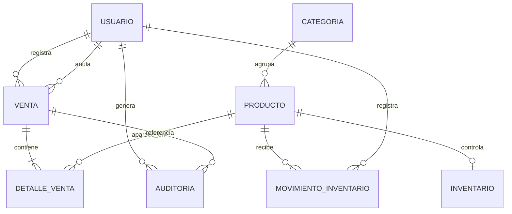

## 4. Modelo de datos conceptual

### 4.1 Restricciones de integridad

1. `Producto.codigo` es único y no nulo.
2. `DetalleVenta.cantidad` es entero positivo; `precio_unitario_cop` es entero no negativo.
3. `Venta.total_cop` equivale a la suma de subtotales de sus detalles.
4. `Venta.estado` pertenece a BORRADOR, CONFIRMADA o ANULADA.
5. `Venta.idempotency_key` es único para evitar duplicados por reintentos.
6. La anulación requiere usuario, fecha y motivo.
7. El inventario no puede quedar negativo si el control está habilitado.
8. No se elimina un producto con relaciones históricas.
